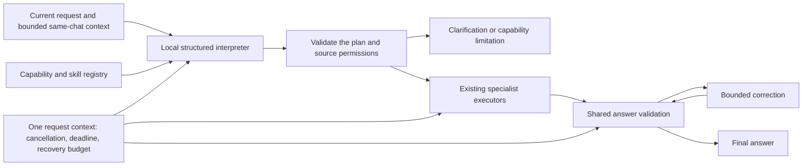

# Shared request pipeline

The chat entry point uses `src/renderer/request-pipeline.js` before choosing an executor. The normal renderer no longer adds separate Hindi/Hinglish poem routing rules. Background metadata generation keeps its existing lightweight path and does not recursively interpret itself.

## Interpretation and capabilities

The plan captures the goal, output capability, language and Unicode script, same-chat context requirement, knowledge scope, changing-fact requirement, deliverables, relevant available skill IDs, response length and any essential clarification. It contains no private reasoning. The registry describes conversation, creative writing, code, tables, document questions, mathematics, optional search/actions and supported visual families. Search/actions remain constrained by actual app settings.

The interpreter calls Ollama on `127.0.0.1` using constrained JSON output, reasoning disabled and a 12-second deadline. Cloud-backed Ollama model names are rejected. Invalid fields, unknown skills and unavailable capabilities cannot authorize a tool. Malformed, low-confidence or timed-out plans fall back to a direct conversational answer with the original request; this fallback does not infer tool actions from keywords. Relevant same-chat context remains bounded. Attachments are reported as available input, and file contents do not become interpreter instructions.

Known explicit visual requests retain the existing deterministic family adapter so an uncertain small interpreter cannot downgrade a working diagram into search or a generic flowchart. Other requests, including unfamiliar language/wording, use the structured plan. The visual renderer takes the validated family and optional table deliverable directly. This preserves current working visual paths while consolidating orchestration; specialized parsers/renderers remain separate.

## Lifecycle and source isolation

Each foreground request has one controller, a six-minute overall deadline, captured chat ownership, and a shared allowance of at most two recovery attempts. Quality and transport recovery each have a one-attempt sublimit; visual validation can use at most two. Continuation also consumes that pool. The initial interpretation call has no repair loop. A failed local foreground execution does not silently fall back to a cloud model. Explicitly selected providers retain their normal generation path; interpretation and fulfillment assessment remain local.

Stop aborts the context, readers and harness, suppresses late callbacks, and cancels pending typing/painting. The deadline also finalizes the UI if a stalled executor does not settle promptly. New requests cannot inherit the old request's completion or final cleanup. Interpreter, evaluator and transport waits are bounded and propagate cancellation.

Search and action adapters capture this same controller and share its recovery budget. Action tools check cancellation before and after execution. Background titles, summaries and compaction use an independent 45-second controller and do not import foreground retrieval, project instructions, visual routing or full conversation history; their callers supply the bounded content to summarize.

Knowledge retrieval receives the validated plan. `none` and `pinned` do not initiate an index search. `project` requires enabled, scoped project knowledge. Global retrieval requires explicit UI selection or an exact supporting phrase from the current request recorded by the interpreter. Project boundaries and the global retrieval toggle remain authoritative. Explicitly pinned files remain user-provided context. The registry also bounds skill selection to listed IDs.

## Answer validation and uncertainty

Shared deterministic checks cover empty answers, greeting substitution, required tables/code, visual family, requested writing script and unauthorized sources. Existing visual/data validators remain responsible for point values, relationships, rendering and chart syntax. Specialist outcomes (`clarify`, `unavailable`, `failed`) are not misrepresented as malformed successful artifacts.

Free-form ready plans also receive a bounded local fulfillment assessment. This checks goal/language/context mismatches across languages, rather than adding a greeting pattern for each language. It has a five-second deadline and does not claim to verify facts from model memory. A timeout or uncertain judgment does not trigger repeated calls or pretend that verification passed. A clear mismatch can use the same one-attempt quality correction budget. Final validation occurs again before accepting a repair.

This architecture cannot make every installed model reliable. A live check with the installed 0.5B model produced invalid plans; those were rejected safely. Structured planning, multilingual understanding and semantic judgment still depend on local model capability. No larger model is downloaded or selected automatically merely to make interpretation pass.

## Verification

`tests/request-pipeline.test.js` exercises the schema, capability availability, multilingual plan contracts, semantic mismatches, source permissions, fallback, local-only network access, cancellation/deadlines, shared retry budgets and visual compatibility. `request-cancellation.test.js`, `knowledge-context.test.js`, `visual-routing.test.js` and `conversation-context.test.js` cover the integration boundaries. Visual rendering has separate Electron checks. `npm test` includes the shared pipeline suite.
